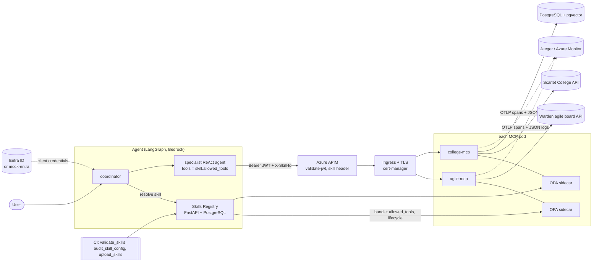

# Architecture

## A tool call, step by step

1. The coordinator resolves the request to a skill through the registry (`/resolve`: aliases, name,
   description) and checks the skill's preflight inputs; a missing required input ends the run with a
   question instead of a guess.
2. It gets an access token for its own app registration (client credentials) and opens MCP sessions
   only to the servers named in the skill's `allowed_tools`, sending `Authorization` and `X-Skill-Id`.
3. APIM rejects the request unless the token is a valid Entra v2 token for `api://beast-assist` with a
   Tools role, and requires the skill header (Consumption allows no per-app rate limit).
4. The MCP server validates the token again (signature against the tenant JWKS, issuer, audience,
   expiry). Defence in depth: a request that bypasses APIM inside the cluster still needs a real token.
5. `tools/list` is filtered to the skill's tools on this server, so the model never sees the rest.
6. `tools/call` asks OPA: is the skill registered, may its lifecycle stage run in this environment,
   is `server:tool` in its `allowed_tools`, and does the token carry Tools.Read (+ Tools.Write for a
   write tool)? OPA's answer includes the reasons, which go back to the model verbatim.
7. The tool runs inside a span (`tool agile-mcp:create_task`, attributes `beast.skill`, `beast.tool`,
   `beast.outcome`) and a JSON log line records duration, outcome, skill and caller.
8. Backend failures surface as `code: message Next: hint`, so the agent's error table in the skill
   can match the code and do the documented thing.

## Why these boundaries

- **One backend per server.** A server's blast radius, credentials and scaling are one system's. A new
  system is a new server from `mcp-template/`, never a new module in an existing one.
- **One tool per file, auto-discovered.** Adding a tool is adding a file; reviews stay small, and the
  model-facing docstring sits next to the code it describes.
- **The skill is the authorization scope.** Tokens say who the caller is; skills say what a task may
  touch. OPA joins the two, so least privilege is per task, not per identity.
- **Lifecycle in policy.** A beta skill runs in dev and staging only; promotion to production is a
  registry change that requires `audit_skill_config.py` to pass and an eval scenario to exist.
- **Stateless MCP over HTTP.** No session affinity: any replica answers any call, so the HPA can scale
  freely.
